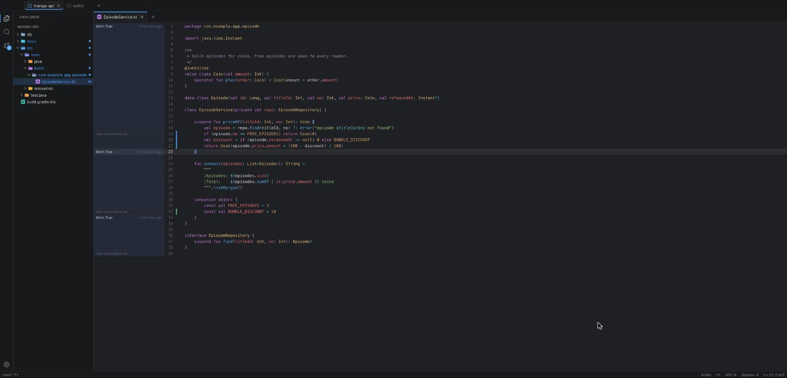
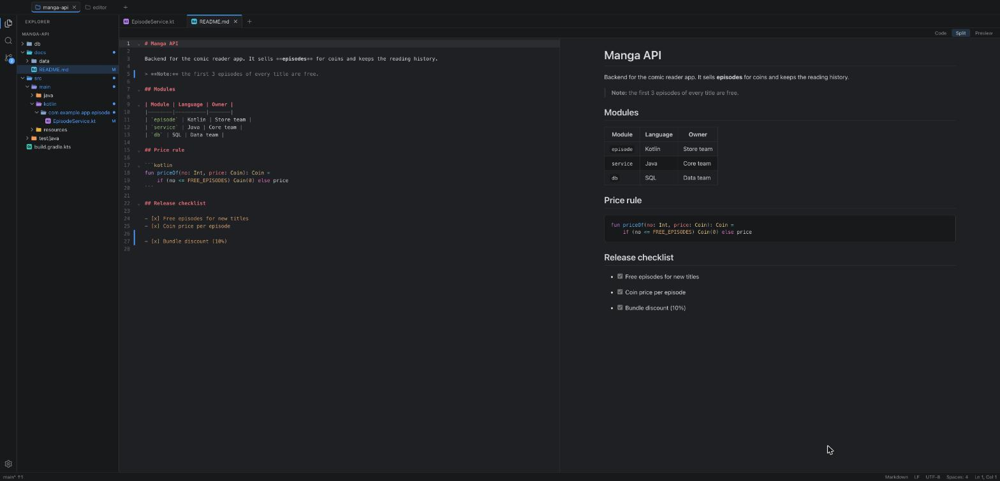
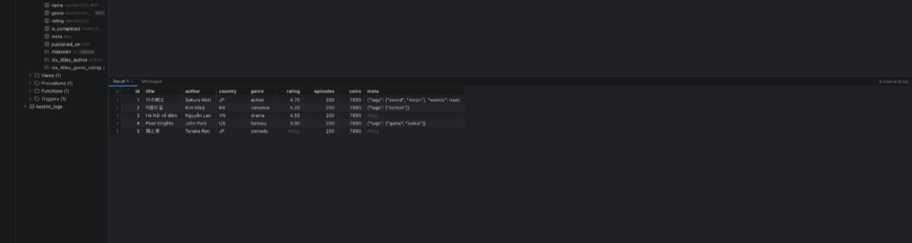
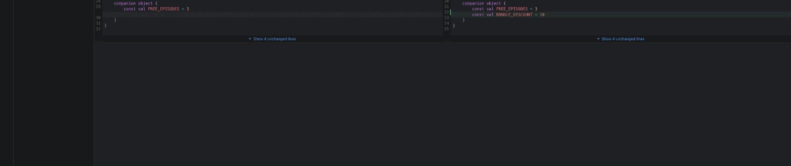
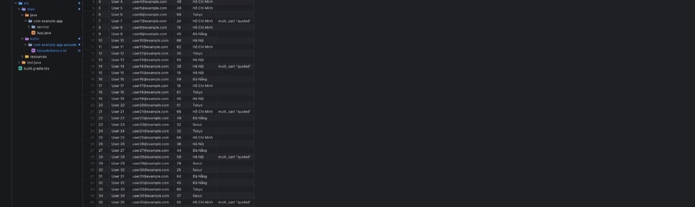
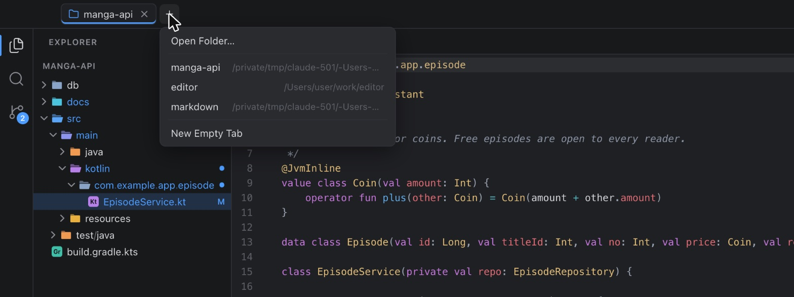

<p align="center">
  
</p>

<h1 align="center">Kestrel</h1>

<p align="center">
  A small, fast code editor.<br>
  Read, review and fix code in the age of AI agents.
</p>

<p align="center">
  
</p>

Kestrel is a code editor for the daily work of a developer: read, review and
fix code. It has what that work needs and leaves out the rest. You can change
it, and **feature requests are welcome** (see [Feature requests](#feature-requests)).

## Why Kestrel

IntelliJ IDEA is a great IDE, but it is heavy. It takes a long time to start,
indexes the whole project before it is useful, and uses gigabytes of memory.
You pay that price every time you want to look at code.

With AI agents, more and more code is written by the agent. Your day moves from
typing code to **reading it**: you review what the agent changed, follow the
diff and the history, read the plans and docs it wrote in Markdown, check the
data in the database, and make small fixes. Kestrel is built for this work,
and its goal is to replace IntelliJ IDEA for it:

- It opens in about half a second and the app process uses about 30 MB.
- Several repositories stay open side by side as workspace tabs.
- Diff, file history and blame are one key away.
- Markdown, HTML and CSV files open as rendered views as well as text.
- A MySQL console with transactions and DDL is built in.
- Language servers give you completion and go to definition when you need them.

## Why the name

A kestrel is a small falcon. It weighs about 200 grams. It can hang still in
the wind above a field, watch the ground for a long time, and then drop on its
target in a second. The editor tries to work the same way: light, able to hover
over a big codebase so you see the whole picture, and quick when you go down to
the exact line.

## Screenshots

| | |
|---|---|
| **Markdown, split view** <br>  | **MySQL console** <br>  |
| **Diff of local changes** <br>  | **File history** <br>  |
| **CSV as a table** <br>  | **Open folders in workspace tabs** <br>  |

## Features

- **Workspace tabs.** Open several folders in one window. Each folder is a tab
  in the title bar and keeps its own editors, git state and language servers.
  Switching tabs is instant.
- **Big files and big folders.** Directory walk, search, git and markdown
  rendering run in Rust threads. Long lists only draw the visible rows.
- **Syntax colors** for Kotlin, Java, JavaScript, TypeScript, Python, HTML,
  CSS, SQL, JSON, Markdown, XML, YAML, Rust, Go, C++, Groovy and more.
- **Viewers.** Markdown and HTML preview (code, split or preview mode), CSV and
  TSV as a sortable table, images.
- **Git.** Changes view, side-by-side and unified diff, compare with any branch,
  file history, blame, and changed lines in the editor gutter.
- **MySQL.** Saved connections (password in the OS keychain, SSH tunnel),
  schema tree, SQL console with auto-commit on or off, commit and rollback,
  result grid, DDL viewer, and run-the-statement for `.sql` files. See
  [Database](#database-mysql).
- **Language servers (LSP)** for Kotlin, Java, JavaScript and TypeScript:
  completion, hover, go to definition, references, rename, format, problems.
  See [docs/LSP.md](docs/LSP.md).
- **Explorer** with file type icons, git colors, and compact folders like
  IntelliJ (`src/main/java`, then `com.example.app`).
- **Drafts.** Press Mod-n or the "+" in the tab bar to get a new file without
  choosing a place first. Drafts save by themselves and come back after a
  restart.
- **Auto save** by default. You can switch to manual save in Settings.
- **UTF-8 by default.** Kestrel detects other encodings (Shift_JIS, EUC-KR,
  UTF-16, ...), keeps the BOM and the line endings, and can re-open or save a
  file with another encoding.
- Quick open, find in files, light and dark theme, zoom for the editor, the
  preview and the whole window.

## Install on macOS

You need macOS 11 or newer, and the tools in "Build from source" below.

### Build the app

```sh
npm install
npm run app
```

`npm run app` makes a release build of `Kestrel.app` (no DMG) and puts the
newest copy in the repository folder: `./Kestrel.app`. Open it from Finder or
with `open Kestrel.app`. Run the command again after you change the code; it
replaces the old copy.

`npm run app:open` does the same, then quits a running Kestrel and starts the
new build.

To keep a copy in Applications:

```sh
cp -R Kestrel.app /Applications/
```

The app is signed ad hoc, not with an Apple Developer ID. An app you build on
your own Mac opens without a warning. If you copy it to another Mac (for
example by chat or a download), macOS blocks the first start with "Apple could
not verify Kestrel". On that Mac, right-click the app, choose **Open**, then
**Open** again. Or run:

```sh
xattr -dr com.apple.quarantine /Applications/Kestrel.app
```

### Open a folder from Terminal

macOS passes the folder to Kestrel with `open`:

```sh
open -na ~/work/editor/Kestrel.app --args ~/work/my-project
```

Add this function to `~/.zshrc` to type `kestrel .` like `code .`
(change the path if your copy is in another place):

```sh
kestrel() { open -na ~/work/editor/Kestrel.app --args "$(cd "${1:-.}" && pwd)"; }
```

### Installers for other people

`npm run tauri build` also makes a DMG in `target/release/bundle/dmg/`. For an
app that runs on Apple Silicon and Intel Macs:

```sh
rustup target add x86_64-apple-darwin aarch64-apple-darwin
npm run tauri build -- --target universal-apple-darwin
```

### Uninstall

Delete `Kestrel.app`. To remove the settings and the saved state too, delete
`~/Library/Application Support/dev.kestrel.editor/` and
`~/Library/Caches/dev.kestrel.editor/`.

## Install on Windows and Linux

There is no ready-made installer yet. Build it from source (next section).
`npm run tauri build` makes these files in `target/release/bundle/`:

| System | Files |
|--------|-------|
| Windows | an `.msi` installer (`msi/`) and a `-setup.exe` installer (`nsis/`) |
| Linux | `.deb`, `.rpm` and `.AppImage` packages (`deb/`, `rpm/`, `appimage/`) |

Only macOS builds have been tested so far.

## Build from source

All systems need:

- [Rust](https://rustup.rs) (stable)
- Node.js 20 or newer
- `git` in your PATH (the Git features use it)

macOS:

```sh
xcode-select --install
```

Windows:

- Microsoft C++ Build Tools ("Desktop development with C++")
- WebView2. Windows 10 (recent updates) and Windows 11 already have it.

Linux (Debian or Ubuntu package names):

```sh
sudo apt-get install -y libwebkit2gtk-4.1-dev libgtk-3-dev \
  libayatana-appindicator3-dev librsvg2-dev libssl-dev libxdo-dev \
  build-essential curl wget file
```

For other Linux systems, see the
[Tauri prerequisites](https://v2.tauri.app/start/prerequisites/).

Then:

```sh
git clone https://github.com/datlt/kestrel.git
cd kestrel
npm install
npm run tauri dev      # run with live reload
npm run app            # build ./Kestrel.app (macOS)
npm run tauri build    # build the app and the installers
```

## Language servers

Kestrel does not include the language servers. Install the ones you need:

| Language | Install |
|----------|---------|
| Kotlin | `brew install JetBrains/utils/kotlin-lsp` (needs Java 17+) |
| Java | `brew install jdtls` (needs Java 21+) |
| JavaScript, TypeScript | `npm install -g typescript typescript-language-server` |

Kestrel finds them in the PATH of your login shell, also when you start it from
the Dock. Details, settings and troubleshooting are in
[docs/LSP.md](docs/LSP.md).

## Database (MySQL)

Open the **Database** view with Ctrl-Shift-d (or the database icon on the left).

1. Click **+** and fill in the connection: host, port, user, password, default
   database, TLS mode.
   - **Save password in keychain** keeps the password in the macOS Keychain
     (Windows Credential Manager, Linux Secret Service). Without it, Kestrel
     asks for the password once per session. Passwords are never written to
     `settings.json`.
   - **SSH tunnel**: Kestrel runs your system `ssh`, so `~/.ssh/config`, keys
     and the ssh agent work. Password login for ssh is not supported.
   - **Production database** shows a red bar in the console and asks before
     statements that change data. **Read-only** makes every session read only.
2. Click **Test Connection**, then **Save**.
3. Expand the connection to see databases, tables, columns, indexes, views,
   procedures, functions and triggers. Right-click a table for **Select Top
   100**, **New SQL Console** and **Show DDL**.

In a SQL console:

| Action | Keys |
|--------|------|
| Run the selection or the statement at the cursor | Mod-Enter |
| Run the whole script | Mod-Shift-Enter |
| Cancel the running statement | Mod-. |
| New SQL console | Mod-Alt-n |

- **Auto-commit** is on by default. Turn it off to work in a transaction; the
  toolbar shows a **TRANSACTION** badge and enables **Commit** and
  **Rollback**. Closing a console with an open transaction asks Commit,
  Rollback or Cancel.
- UPDATE or DELETE without WHERE always asks first.
- Each result set gets its own tab. Right-click the grid to copy rows as TSV,
  JSON or INSERT statements, or to export a CSV file. The **Messages** tab
  lists every statement with its time, rows and errors.
- In a `.sql` file of your project, choose a connection in the status bar and
  press Mod-Enter to run the statement at the cursor.

To try it without a real database, `scripts/dev-mysql.sh start` runs a local
MySQL 8 in Docker on 127.0.0.1:13306 with sample data (the user and the test
password are in the script). `scripts/dev-mysql.sh stop` removes it.

## Settings

Open the Settings screen with **Mod-,** (or the gear at the bottom left). Each
change applies at once. The values are stored in `settings.json`. The command
"Open Settings (JSON)" opens that file; it allows comments and trailing commas.

| System | Folder of `settings.json` |
|--------|---------------------------|
| macOS | `~/Library/Application Support/dev.kestrel.editor/` |
| Windows | `%APPDATA%\dev.kestrel.editor\` |
| Linux | `~/.config/dev.kestrel.editor/` (or `$XDG_CONFIG_HOME/dev.kestrel.editor/`) |

Main settings:

| Key | Default | Meaning |
|-----|---------|---------|
| `theme` | `"system"` | `"system"`, `"light"` or `"dark"` |
| `editor.fontSize` | `13` | Editor font size |
| `editor.tabSize` | `4` | Spaces per tab |
| `editor.wordWrap` | `false` | Wrap long lines |
| `editor.largeFileMB` | `8` | Bigger files open in plain mode (no colors, no LSP) |
| `files.autoSave` | `"afterDelay"` | `"afterDelay"`, `"onFocusChange"`, or `"off"` to save by hand |
| `files.autoSaveDelayMs` | `1000` | Wait time before an auto save |
| `files.exclude` | `.git`, `.DS_Store`, `Thumbs.db` | Hidden in the Explorer |
| `explorer.compactFolders` | `true` | Show single-child folder chains as one row |
| `preview.markdownMode` | `"preview"` | Start mode of Markdown files: `"code"`, `"split"` or `"preview"` |
| `preview.htmlMode` | `"preview"` | Start mode of HTML files |
| `preview.htmlScripts` | `true` | Run scripts in the HTML preview (in a sandbox) |
| `preview.csvMode` | `"preview"` | Start mode of CSV and TSV files (`"code"` = raw text) |
| `git.gutter` | `true` | Show changed lines in the gutter |
| `lsp.enabled` | `true` | Turn language servers on or off |
| `lsp.servers` | Kotlin, Java, TypeScript | Server commands, see [docs/LSP.md](docs/LSP.md) |
| `db.maxRows` | `1000` | Rows fetched per result in a SQL console |
| `db.confirmWrites` | `"production"` | Ask before data changes: `"production"`, `"always"` or `"never"` |
| `db.showSystemSchemas` | `false` | Show `mysql`, `sys`, `information_schema`, `performance_schema` |

## Keyboard shortcuts

`Mod` is Cmd on macOS and Ctrl on Windows and Linux.

| Action | Keys |
|--------|------|
| Command palette | Mod-Shift-p, F1 |
| Quick open (find a file) | Mod-p |
| Find in files | Mod-Shift-f |
| Find, replace in the file | Mod-f; Mod-Alt-f (macOS) or Mod-h |
| Go to line | Ctrl-g |
| New draft | Mod-n |
| Save, save as, save all | Mod-s, Mod-Shift-s, Mod-Alt-s |
| Close tab, reopen closed tab | Mod-w, Mod-Shift-t |
| Next or previous editor tab | Ctrl-Tab, Ctrl-Shift-Tab |
| Next or previous workspace tab | Mod-Shift-], Mod-Shift-[ |
| Workspace tab 1 to 9 | Mod-1 ... Mod-9 |
| Open folder (in a workspace tab) | Mod-o |
| Open recent folder | Mod-r |
| New window | Mod-Shift-n |
| Settings | Mod-, |
| Toggle sidebar, bottom panel | Mod-b, Mod-j |
| Show Explorer, Git | Mod-Shift-e, Ctrl-Shift-g |
| Editor zoom in, out, reset | Mod-=, Mod--, Mod-0 |
| Window zoom in, out, reset | Mod-Alt-=, Mod-Alt--, Mod-Alt-0 |
| Toggle word wrap | Alt-z |
| Code or preview, code or split | Mod-Shift-v, Mod-Alt-v |
| Diff of the active file | Mod-Alt-d |
| Git history of the active file | Mod-Alt-h |
| Toggle git blame | Mod-Alt-b |
| Next or previous change | Alt-F5, Shift-Alt-F5 |
| Go to definition | F12, Mod-click |
| Find references | Shift-F12 |
| Rename symbol | F2 |
| Format document | Shift-Alt-f |
| Workspace symbols | Mod-t |
| Database view | Ctrl-Shift-d |
| Run SQL statement, run script | Mod-Enter, Mod-Shift-Enter |

All other commands are in the command palette.

## Development

```sh
npm run typecheck        # TypeScript
npm test                 # Vitest, src/**/*.test.ts
cargo test --workspace   # Rust
```

- `scripts/fixtures.sh <folder>` makes a test folder with sample files, big
  files and a git repository.
- `scripts/measure.sh` measures the start time and the memory of a release build.
- `scripts/dev-mysql.sh` starts a test MySQL server. `KESTREL_TEST_MYSQL=127.0.0.1:13306 cargo test -p kestrel-db`
  runs the database tests against it.
- `src/dev/README.md` explains how to run the UI in a normal browser with real
  files (useful for UI tests with browser tools). For database features also
  run `cargo run -p kestrel-db --example dev_http`.

Project layout:

```
src/            Web view code (TypeScript)
  core/         Event bus, commands, settings, shared types
  window/       Workspace tabs and the window
  shell/        Layout, editor tabs, status bar, quick pick, palette
  editor/       CodeMirror editors, languages, drafts, auto save
  features/     files, search, git, lsp, preview, settings, db
  ui/           File type icons
  ipc/          Typed wrappers of the Rust commands
src-tauri/      The Tauri app (Rust): thin command layer
crates/         Rust logic without Tauri (common, fs, search, git, lsp, markdown, db)
docs/           Design and guides
scripts/        Test fixtures, measuring, dev bridge
```

The full design is in [docs/DESIGN.md](docs/DESIGN.md).

## Measured speed

Release build on an Apple Silicon Mac (macOS 26), opening a small git repo.

| What | Result |
|------|--------|
| App size (frontend inside) | 10 MB |
| Start to visible window (warm) | 350 to 600 ms, depending on the load of the machine; about 245 ms of it is macOS starting the web view |
| Memory of the app process (physical footprint) | about 30 MB |
| Quick open query, 300k files | 2 to 10 ms |

The web view runs in separate system processes (WebContent, GPU, Networking).
On macOS they use about 100 MB more.

## Known limits

- Kestrel runs `git` in every folder you open. Git can run programs from the
  repository config (for example `core.fsmonitor` or filters). Open only
  folders you trust.
- Scripts in HTML previews run by default, inside a sandboxed frame without
  access to the app. Turn them off with `preview.htmlScripts` if you open HTML
  files you do not trust.
- The app is not notarized by Apple (see "Install on macOS").
- MySQL TLS modes `preferred` and `required` encrypt the connection but do not
  check the server certificate.
- There is no terminal, no debugger and no extension system.

## Feature requests

If something is missing, slow or in your way, open an issue at
<https://github.com/datlt/kestrel/issues>. Please write:

- what you want to do (for example "review a pull request branch"),
- what you do today instead, and
- a screenshot or an example file when it helps.

Pull requests are welcome too. Read [docs/DESIGN.md](docs/DESIGN.md) first: it
explains the parts and the rules that keep Kestrel small and fast.

## License

MIT
